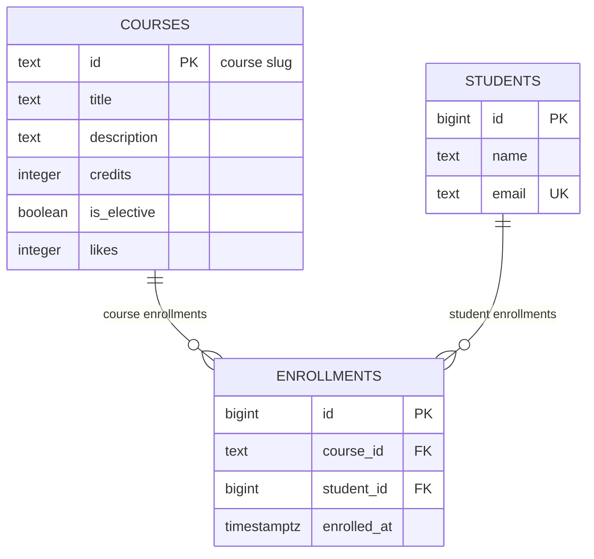

# course-catalog-db

PostgreSQL schema for the Course Catalog project — Lab 6, Advanced Web Technologies.

This lab moves the catalog data model from temporary application memory into a relational PostgreSQL schema. The FastAPI and Next.js projects are not changed in this lab; database integration into FastAPI comes in the next lab.

## How to run

PostgreSQL 16 or newer is required.

Create the application role and databases once as the `postgres` superuser:

```sql
CREATE ROLE catalog_app LOGIN PASSWORD 'change-me';
CREATE DATABASE course_catalog OWNER catalog_app;
CREATE DATABASE idx_demo OWNER catalog_app;
CREATE DATABASE norm_demo OWNER catalog_app;
```

On Windows, if non-English text is used, set UTF-8 before starting psql:

```powershell
$env:PGCLIENTENCODING = "UTF8"
```

From the project folder:

```bash
psql -h localhost -U catalog_app -d course_catalog -v ON_ERROR_STOP=1 -f schema.sql
psql -h localhost -U catalog_app -d course_catalog -v ON_ERROR_STOP=1 -f seed.sql
psql -h localhost -U catalog_app -d course_catalog -v ON_ERROR_STOP=1 -f queries.sql
```

Teaching password: `change-me`. Real passwords must not be committed to Git.

Expected row counts after `schema.sql` + `seed.sql`:

- courses: 6
- students: 3
- enrollments: 6

## Schema



`courses` stores each course once and `students` stores each student once. `enrollments` is a junction table connecting them. This creates a many-to-many relationship: one student can enroll in many courses, and one course can contain many students.

## Design decisions

- `courses.id` is `text` because the existing application already uses stable, readable slugs such as `web-security` in URLs. `students.id` is an automatic `bigint` because students need an internal identifier without inventing a public slug. Text slugs are readable but harder to rename; numeric IDs are compact and easy to generate.
- `ON DELETE RESTRICT` is used for `enrollments.course_id` so a course with enrollment records cannot disappear accidentally. `ON DELETE CASCADE` is used for `enrollments.student_id` so deleting a student also removes rows that only describe that student's enrollments.
- `timestamptz` is used for `enrolled_at` because an enrollment is an absolute moment in time and should stay unambiguous across time zones. PostgreSQL `text` is used instead of arbitrary `varchar(n)` limits; real domain limits are expressed with `CHECK` constraints where needed.

## Constraint violation log

Commands are run with:

```text
\set VERBOSITY verbose
```

| # | What we violate | SQLSTATE | Constraint / column | API response |
|---|-----------------|----------|---------------------|--------------|
| 1 | NULL in `courses.title` | 23502 | column `title` (`NOT NULL`) | 422; if Pydantic allowed it through, that would indicate an application bug |
| 2 | `courses.credits = 0` | 23514 | `courses_credits_check` | 422 |
| 3 | `courses.likes = -1` | 23514 | `courses_likes_check` | 500, because only application code should update the counter |
| 4 | one-letter student name | 23514 | `students_name_check` | 422 |
| 5 | duplicate student email | 23505 | `students_email_key` | 409 Conflict |
| 6 | duplicate course id | 23505 | `courses_pkey` | 409 Conflict |
| 7 | repeated enrollment in the same course | 23505 | `enrollments_course_id_student_id_key` | 409 Conflict |
| 8 | enrollment in a nonexistent course | 23503 | `enrollments_course_id_fkey` | 404 Course not found |
| 9 | enrollment for a nonexistent student | 23503 | `enrollments_student_id_fkey` | 404 Student not found |
| 10 | deleting a course that has enrollments | 23001 on PostgreSQL 18; 23503 on PostgreSQL 16/17 | `enrollments_course_id_fkey` | 409 Conflict |
| 11 | deleting a student | no violation | `ON DELETE CASCADE` | their enrollments are deleted automatically; in the experiment 6 → 3, and ROLLBACK restores 6 |

### Why repeat validation in PostgreSQL if Pydantic already validates?

Pydantic protects data that enters through this FastAPI application, but the API is not the only possible writer. SQL scripts, an admin tool, another service, or future code can write directly to the database. Database constraints protect the data regardless of which client performs the write, so important domain rules belong in the database as well.

## Constraint experiment commands

Run one at a time:

```sql
-- 1
INSERT INTO courses (id, title, description, credits)
VALUES ('x-test', NULL, 'Test', 3);

-- 2
INSERT INTO courses (id, title, description, credits)
VALUES ('x-test', 'Test', 'Test', 0);

-- 3
UPDATE courses SET likes = -1 WHERE id = 'api-design';

-- 4
INSERT INTO students (name, email) VALUES ('A', 'a@example.com');

-- 5
INSERT INTO students (name, email)
VALUES ('Dup Student', 'aigerim@example.com');

-- 6
INSERT INTO courses (id, title, description, credits)
VALUES ('api-design', 'x', 'y', 1);

-- 7
INSERT INTO enrollments (course_id, student_id)
VALUES ('modern-frontend', 1);

-- 8
INSERT INTO enrollments (course_id, student_id)
VALUES ('no-such-course', 1);

-- 9
INSERT INTO enrollments (course_id, student_id)
VALUES ('web-security', 999);

-- 10
DELETE FROM courses WHERE id = 'modern-frontend';
```

Cascade check:

```sql
BEGIN;
SELECT count(*) AS enrollments FROM enrollments;
DELETE FROM students WHERE email = 'daniyar@example.com';
SELECT count(*) AS enrollments FROM enrollments;
ROLLBACK;
SELECT count(*) AS enrollments FROM enrollments;
```

## Index: EXPLAIN before and after

Experiment query:

```sql
SELECT * FROM enrollments WHERE student_id = 777;
```

Use database `idx_demo` with 500 courses, 20,000 students and 50,000 enrollments.

For the **before** experiment, temporarily comment out the final `CREATE INDEX enrollments_student_id_idx ...` line in `schema.sql`, recreate `idx_demo`, and load `experiments/idx_data.sql`.

Typical plan before the index:

```text
Seq Scan on enrollments
  Filter: (student_id = 777)
```

The lab handout example reports:

```text
Rows Removed by Filter: 49997
Execution Time: 3.636 ms
```

Then create:

```sql
CREATE INDEX enrollments_student_id_idx ON enrollments (student_id);
```

Typical plan after the index:

```text
Bitmap Heap Scan on enrollments
  Recheck Cond: (student_id = 777)
  -> Bitmap Index Scan on enrollments_student_id_idx
       Index Cond: (student_id = 777)
```

Fill the timing from your own machine before submission:

| | Before the index | After the index |
|---|---|---|
| Access method | Seq Scan | Bitmap Heap/Index Scan |
| Estimated cost | about `0.00..1042.00` in the handout | about `4.31..15.59` in the handout |
| Rows Removed by Filter | 49997 | normally 0 / not shown |
| Execution Time | handout example: 3.636 ms | **replace with your local EXPLAIN ANALYZE result** |

### Index questions

1. PostgreSQL automatically creates indexes for `PRIMARY KEY` and `UNIQUE` constraints, but it does not automatically create an index for the referencing side of a `FOREIGN KEY`. Therefore `students.email` and the unique `(course_id, student_id)` pair have indexes, while `enrollments.student_id` initially does not.
2. The `courses` table has only six rows, so reading the entire table can be cheaper than traversing an index. On a 50,000-row `enrollments` table the planner estimates that an index is much cheaper. An available index is not automatically chosen; PostgreSQL compares estimated costs.
3. The `student_id` index speeds up finding all enrollments of a student and finding/removing dependent enrollment rows when a student is deleted with `ON DELETE CASCADE`.

## Transaction

Scenario: enrolling a new student is two dependent inserts — first `students`, then `enrollments`.

Failure experiment:

```sql
BEGIN;

INSERT INTO students (name, email)
VALUES ('Madina Ospanova', 'madina@example.com');

INSERT INTO enrollments (course_id, student_id)
SELECT 'no-such-course', id
FROM students
WHERE email = 'madina@example.com';

ROLLBACK;
```

The second insert fails with a foreign-key violation. PostgreSQL marks the transaction as aborted, and commands are ignored until `ROLLBACK`. After `ROLLBACK`, the first valid student insert is undone too, so Madina does not remain as a half-finished operation.

Successful two-window experiment:

**Window A**

```sql
BEGIN;

INSERT INTO students (name, email)
VALUES ('Madina Ospanova', 'madina@example.com');

INSERT INTO enrollments (course_id, student_id)
SELECT 'web-security', id
FROM students
WHERE email = 'madina@example.com';
```

**Window B, before COMMIT**

```sql
SELECT count(*) FROM students WHERE email = 'madina@example.com';
```

Result: `0`.

**Window A**

```sql
COMMIT;
```

**Window B, after COMMIT**

```sql
SELECT count(*) FROM students WHERE email = 'madina@example.com';
```

Result: `1`.

Before `COMMIT`, another client cannot see the uncommitted data. After `COMMIT`, both inserts become visible together. Without a transaction, if the second insert failed, the first insert would remain and the database could contain a student with no intended enrollment.

## Self-review against the checklist

| What to check | Result |
|---|---|
| Keys | Yes — all three tables have primary keys; enrollments has foreign keys to courses and students. |
| Types | Yes — slugs/names use text, internal numeric IDs use bigint identity, the enrollment moment uses timestamptz. |
| Required values | Yes — all domain-required columns are NOT NULL. |
| Constraints | Yes — positive credits, non-negative likes, minimum student-name length, unique email, unique course/student enrollment. |
| Deletion | Yes — course deletion is RESTRICTed when referenced; student deletion CASCADEs to their enrollment rows. |
| Normalization | Yes — course and student facts are stored once; the many-to-many relationship is represented by enrollments. |
| Indexes and names | Yes — primary/unique indexes are present and `enrollments_student_id_idx` covers the foreign-key lookup; names use snake_case consistently. |

## Useful checks

```sql
\dt
\d courses
\d students
\d enrollments

SELECT
    (SELECT count(*) FROM courses) AS courses,
    (SELECT count(*) FROM students) AS students,
    (SELECT count(*) FROM enrollments) AS enrollments;
```

Expected after a clean seed:

```text
courses = 6
students = 3
enrollments = 6
```

## Notes

`schema.sql` deliberately drops the three tables first so the lab can be rerun from a clean state. Real production projects preserve data and change the schema using migrations; that will be introduced with SQLAlchemy/Alembic later.
